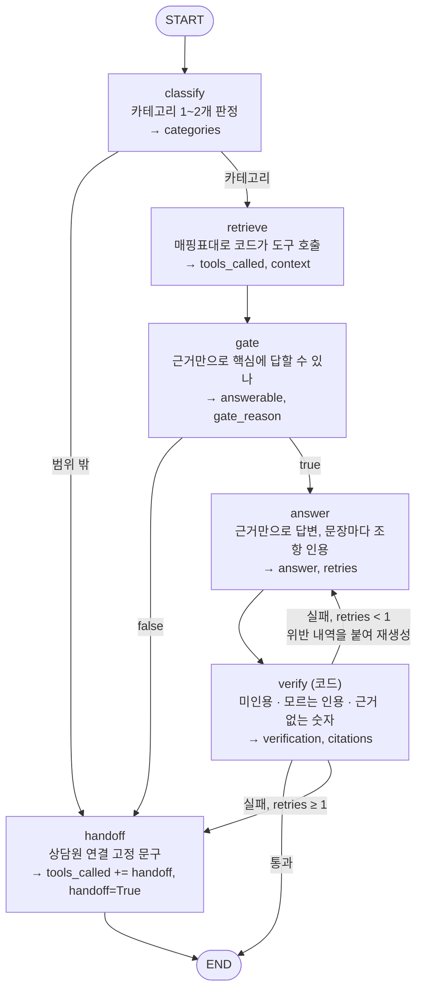
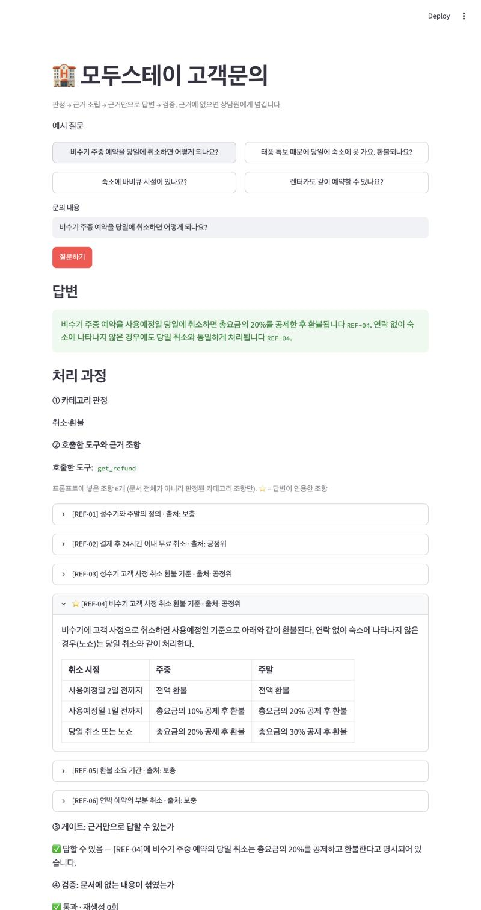
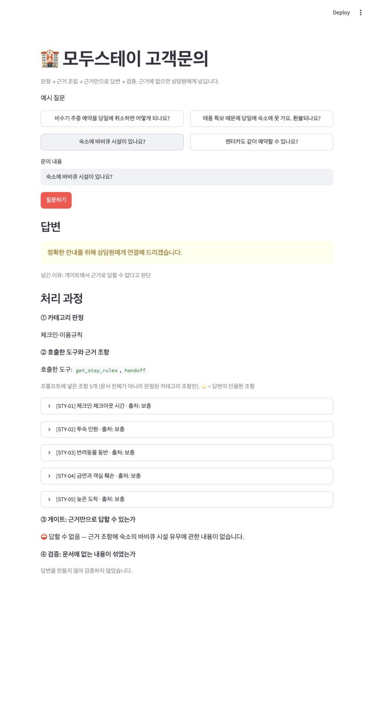
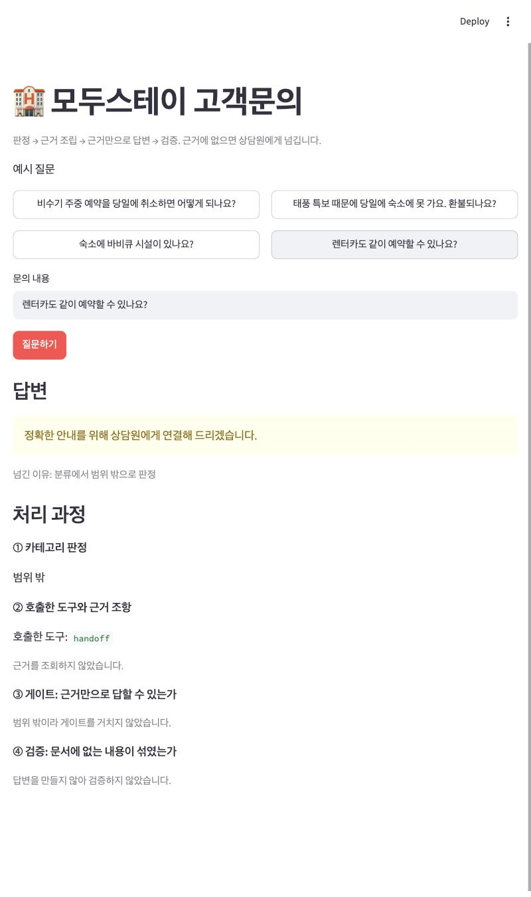

# REPORT — 모두스테이 고객문의 라우팅 에이전트

> 입력 하나 → ① 카테고리 판정 → ② 카테고리별 근거 조립 → ③ 근거만으로 답변 → ④ 검증, 모르면 상담원에게 넘기기.
> 가상 숙박 예약 플랫폼 **모두스테이**의 고객문의를 소재로 이 구조를 구현하고 성능을 숫자로 측정했다.

**최종 성능** (최종 설정을 4회 측정한 평균): 도구 호출 적절성 **0.950**, 답변 적절성 **0.938**. 넘겨야 할 문항에서 지어낸 답은 **0건**.

| 문서 | 내용 |
|---|---|
| [PRD.md](PRD.md) · [TECH_SPEC.md](TECH_SPEC.md) | 요구 사항 · 기술 명세 |
| [WORK_UNITS.md](WORK_UNITS.md) · [FINAL_CHECKLIST.md](FINAL_CHECKLIST.md) | 단위 작업과 완료조건 · 제출 전 점검표 |
| [results/ANALYSIS.md](results/ANALYSIS.md) | 회차별 오답 분석 원본 |

---

## 1. 주제와 근거 문서

### 무엇을 골랐나
숙박 예약 플랫폼의 고객문의 응대. 근거 문서는 [docs/policy_modustay.md](docs/policy_modustay.md)이고 조항은 22개다.
- **공정거래위원회 「소비자분쟁해결기준」 숙박업 기준** (8개 조항): 고객 사정 취소 환급표, 숙소 사정 취소 배상표, 천재지변·감염병 기준, 결제 후 24시간 무위약금 취소(2024-12 개정)
- **모두스테이 보충 정책** (14개 조항): 공정위 문서에 없는 예약·결제, 체크인·이용규칙, 객실 하자·오버부킹 처리 절차

원문을 어디서 확인했는지는 [docs/sources.md](docs/sources.md)에 적었다.

### 왜 골랐나
- **그럴듯한 오답이 많은 영역이다.** "보통 하루 전까지 무료 취소", "성수기 표시가 없으면 비수기" 같은 상식형 답이 실제 기준과 다르다. 문서 없이 답하면 틀리기 쉬워서, 검증 단계가 왜 필요한지 잘 드러난다.
- **비율·기간 같은 숫자가 많다.** 숫자 대조로 지어낸 답을 기계적으로 잡아내는 검증을 설계하기 좋다.
- **공공 문서라 공개 저장소에 올려도 저작권 부담이 적다.**

### 문서를 옮기며 내린 판단
- 모두스테이는 예약할 때 전액을 결제한다고 가정했다. 그래서 공정위 기준의 "계약금 환급"을 "전액 환불"로 옮겼다.
- 기본 성수기 기간(7.15~8.24, 12.20~2.20)은 오래된 기사에서만 확인돼 현행 고시와 같은지 알 수 없었다. 그래서 공정위 조항이 아니라 `보충`(모두스테이 자체 정의)으로 표시했다.

---

## 2. 카테고리 설계

### 카테고리와 나눈 근거
문서의 조항 구분을 기준으로 나눴다. 카테고리끼리 보는 조항이 겹치지 않아야 "도구 호출 적절성"을 깔끔하게 잴 수 있기 때문이다.

| 카테고리 | 도구 | 조항 ID | 나눈 근거 |
|---|---|---|---|
| 예약·결제 | `get_booking` | BKG-01~05 | 이용 **전** 절차(확정·결제·예약자 정보). 공정위 문서에 없어 모두 보충 |
| 취소·환불 | `get_refund` | REF-01~06 | **고객 사정** 취소. 공정위 환급표(고객 귀책) + 환불 절차 |
| 체크인·이용규칙 | `get_stay_rules` | STY-01~05 | 이용 **중** 규칙. 숙소마다 다를 수 있는 항목이 많아 "문서에 없음" 문의가 나오기 쉽다 |
| 분쟁·보상 | `get_dispute` | DSP-01~06 + REF-01 | **숙소 사정·불가항력·시설 문제**. 공정위 배상표(사업자 귀책) + 천재지변·감염병 |
| 범위 밖 | `handoff` | — | 모두스테이 숙박 예약·이용 고객의 문의가 아닌 것 |

### 경계 규칙
- **같은 "취소"도 누구 사정인지로 나눈다.** 고객 사정이면 취소·환불, 숙소 사정·천재지변이면 분쟁·보상이다. 과제 예시처럼 "변경·취소"와 "환불"로 나누면 두 카테고리가 같은 환급표를 보게 되기 때문이다.
- **공유 조항(EXTRA_MAP):** 분쟁·보상의 배상표는 성수기·주말 정의(REF-01) 없이는 읽을 수 없다. 그래서 `get_dispute`가 REF-01도 함께 돌려준다. 도구 호출은 `get_dispute` 하나다.
- **두 카테고리 문의:** 예약 변경(BKG-05)은 "취소 후 재예약하며 취소 기준이 적용된다"는 내용이다. 그래서 변경 수수료까지 묻는 문의는 `get_booking`과 `get_refund`를 함께 호출해야 정답이다.

매핑은 [context.py](context.py)의 `PREFIX_CATEGORY` · `CATEGORY_TOOL` · `EXTRA_MAP`이 그대로 구현한다. 조항 ID의 접두어가 곧 카테고리다.

---

## 3. 평가셋 설계

### 구성
[data/goldenset.json](data/goldenset.json)에 **평가용 20건**과 **예시용 5건**을 담았다.

| 카테고리 | 평가 문항 | 구성 |
|---|---|---|
| 예약·결제 | 4 | 답변 3 (그중 1건은 두 카테고리 문의 E03) + 문서에 없음 1 |
| 취소·환불 | 4 | 답변 3 + 문서에 없음 1 |
| 체크인·이용규칙 | 4 | 답변 3 + 문서에 없음 1 |
| 분쟁·보상 | 4 | 답변 3 + 문서에 없음 1 |
| 범위 밖 | 4 | 모두 넘기기 |

넘기는 것이 정답인 문항은 8건이다. 범위 밖형 4건과 문서에 없음형 4건으로 나뉜다.

### 기대 도구를 정한 기준
| 문항 유형 | 기대 도구 | 이유 |
|---|---|---|
| 답할 수 있는 문의 | 해당 카테고리 도구 | 근거 조항이 있는 카테고리 |
| 두 카테고리 문의 | 두 도구 모두 | 한쪽 근거만으로는 답이 완성되지 않는다 |
| 카테고리는 맞지만 문서에 답이 없음 | `get_xxx` + `handoff` | **근거를 읽어 보고 나서** 넘겨야 정답이다 |
| 범위 밖 | `handoff` | 근거를 조회할 필요가 없다 |

### 필수 사실과 금지 표현을 정한 기준
- **필수 사실:** 근거 조항에 적힌 사실을 그대로 옮겼다. 문항마다 `note`에 근거 조항 ID를 적어 두었다.
- **금지 표현:** 문서를 안 읽었을 때 나오기 쉬운 그럴듯한 오답을 넣었다.

| 문항 | 금지 표현 | 문서의 사실 |
|---|---|---|
| E05 성수기 주말 3일 전 취소 | "50% 공제" | 60% 공제 (50%는 성수기 주중 기준) |
| E06 어젯밤 결제, 오늘 취소 | "결제 당일에만 무료" | 결제 후 24시간 이내 무료 (당일은 2024 개정 전 기준) |
| E07 성수기 표시 없는 8월 금요일 | "표시가 없으니 비수기" | 표시가 없으면 7.15~8.24를 성수기로 본다 |
| E13 숙소 사정 취소 | "환불만 되고 배상은 없다" | 전액 환불 + 총요금 10% 배상 |
| E12 주차 (문서에 없음) | "무료 주차 가능" / "주차 불가" | 문서에 없다. 어느 쪽이든 지어낸 답이다 |

- **금액 계산 문항은 넣지 않았다.** "20만 원이면 얼마 돌려받아요?" 같은 질문은 답에 문서에 없는 숫자가 생겨서 숫자 대조 검증과 충돌한다.

### 평가용과 예시용을 가른 방법
- 예시용(`split: "example"`) X01~X05는 분류 few-shot과 답변 형식 예시에만 쓴다. 평가에는 쓰지 않는다. 평가 문항과 겹치는 질문은 없다.
- **프롬프트로 평가 정보가 새는 것을 막았다.** 처음 쓴 분류 지침에 "쿠폰", "서비스 불만", "회사 연락처"가 들어 있었다. 이 단어들은 각각 E08, E16, E19를 겨냥한 것이어서 지웠다. 채점 지침의 예시 문장도 E06의 필수 사실과 거의 같아서, 평가셋에 없는 체크아웃 예시로 바꿨다.

---

## 4. 측정 결과

### 채점기 검증 (측정 전에 먼저)
| 검증 | 결과 |
|---|---|
| 모범 답안 20건 | **20/20** 1점 |
| 일부러 틀린 답 7건 ([data/grader_negatives.json](data/grader_negatives.json)) | **7/7** 0점 |

틀린 답은 네 종류로 만들었다. 숫자가 틀린 답, 필수 사실 일부를 빠뜨린 답, 지어낸 답, 개정 전 기준으로 답한 답이다. 7건 모두 의도한 이유로 0점이 나왔다. 결과는 [results/grader_validation.json](results/grader_validation.json)에 있다.

### 지표
| 지표 | 기준 (run_01) | 최종 (4회 평균) | PRD 목표 |
|---|---|---|---|
| 도구 호출 적절성 | 0.95 | **0.950** (0.90~1.00) | ≥ 0.85 |
| 답변 적절성 | 0.80 | **0.938** (0.90~1.00) | ≥ 0.80 |
| 넘기기 문항에서 지어낸 답 | 0 | **0** | 0 |

### 혼동행렬 (최종 설정 80건)

**① 분류** (행 = 기대, 열 = 예측)

| 기대 \ 예측 | 예약·결제 | 취소·환불 | 체크인·이용규칙 | 분쟁·보상 | 범위 밖 |
|---|---|---|---|---|---|
| 예약·결제 | 16 | 4 ✅ | 0 | 0 | 0 |
| 취소·환불 | 3 ❌ | 16 | 0 | 0 | 0 |
| 체크인·이용규칙 | 0 | 0 | 16 | 0 | 0 |
| 분쟁·보상 | 0 | 0 | 0 | 16 | 0 |
| 범위 밖 | 0 | 0 | 0 | 0 | 16 |

- 혼동은 예약·결제↔취소·환불 경계에서만 생긴다. ✅ 4건은 두 카테고리 문의(E03)라 정답이고, ❌ 3건은 E06에 예약·결제를 덧붙인 오답이다.
- 취소·환불↔분쟁·보상(누구 사정인가)의 혼동은 0건이다. 2절의 경계 규칙이 작동했다.

**② 넘기기** (양성 = 넘김)

| | 실제로 넘김 | 실제로 답함 |
|---|---|---|
| **넘겨야 함** | TP 32 | **FN 0** (지어낸 답) |
| **답해야 함** | FP 3 (과잉 넘김) | TN 45 |

재현율은 1.00, 정밀도는 0.91이다. 답한 45건 중 43건이 답변 적절성 1점을 받았다.

### 틀린 건의 원인 분류
한 문항에 원인이 여러 개 겹치면 각각 센다. 최종 4회에서 틀린 행은 6개다(E06 3회, E02·E03·E05 각 1회).

| 원인 | 기준 (run_01) | 최종 4회 (80건) | 대표 사례 |
|---|---|---|---|
| 사실 누락 (결론만 말함) | 3 | 0 | run_01 E07: "성수기에 해당한다"는 결론만 말하고 기준 기간 7.15~8.24를 생략 → 개선 1로 사라짐 |
| 분류 오류 | 0 | 3 | E06: "취소 수수료" 문의에 예약·결제를 덧붙여 `get_booking`까지 호출. run_04에서는 답변이 맞았는데도 이것 때문에 도구가 오답 |
| 게이트 오류 (답할 수 있는데 넘김) | 1 | 2 | run_03 E03: 질문에 없는 "재예약 시 요금 차이"까지 따져 넘김. run_05 E06: "24시간 이내인지 모른다"며 넘김 |
| 검증 엄격 (인용 누락) | 0 | 1 | run_03 E06: "24시간"이 나오는 문장에 REF-02 대신 REF-01·03·04를 인용해 검증에 두 번 실패 |
| **사실 오류 (검증 통과)** | 0 | 1 | run_05 E05: 정답 60% 대신 표의 한 줄 위 **40%**를 답함. 40%도 REF-03 안에 있는 숫자라 검증을 통과 |
| 채점 오류 | 0 | 1 | run_04 E02: 답은 맞는데 채점기가 금지 표현을 필수 사실 목록에 섞어 "누락"으로 판정. 비교용 run_02 E10도 채점 오류 |

### 개선 시도별 기록표
| 회차 | 바꾼 것 하나 | 도구 | 답변 | 메모 |
|---|---|---|---|---|
| run_01 | 기준 | 0.95 | 0.80 | 사실 누락 3, 게이트 오류 1 |
| run_02 | 답변 규칙 7: 결론과 함께 기준·조건을 쓴다 | 0.95 | 0.90 | 사실 누락 3건 해결 |
| run_03 | 게이트: 조건을 붙여 답할 수 있으면 true | 0.90 | 0.90 | E06 게이트는 통과. 그러나 분류·인용 문제로 실패하고 E03이 회귀 |
| run_04~06 | (개선 2 상태 3회 반복) | 평균 0.967 | 평균 0.950 | 변동 폭 확인 |
| run_07~09 | (개선 1 상태 3회 반복, 비교용) | 평균 0.917 | 평균 0.850 | 개선 2가 더 낫다 → 유지 |

run_03에서 도구 점수가 0.05 떨어졌지만, 같은 설정을 다시 재 보니 결과가 회차마다 흔들렸다(`temperature=0`이어도 그렇다). 그래서 두 설정을 각각 4회씩 쟀다. 개선 2가 두 지표 모두 평균이 높아서 유지했다. 두 설정의 4회 결과는 아래와 같다.

| 설정 | 도구 평균 (범위) | 답변 평균 (범위) |
|---|---|---|
| 개선 1까지 | 0.925 (0.90~0.95) | 0.863 (0.80~0.90) |
| 개선 2까지 (최종) | 0.950 (0.90~1.00) | 0.938 (0.90~1.00) |

회차별 원본은 `results/run_*.json`에 있다. 문항별 분류 결과, 근거 조항, 게이트 사유, 답변, 검증, 채점 근거가 함께 담겨 있다.

---

## 5. 파이프라인 구조도



### 상태 (State)
```python
class AgentState(TypedDict, total=False):
    question: str            # 입력
    categories: list[str]    # classify
    tools_called: list[str]  # retrieve, handoff — 도구 호출 적절성의 채점 대상
    context: list[Clause]    # retrieve — 판정된 카테고리 조항만 (문서 전체 X)
    answerable: bool         # gate
    gate_reason: str         # gate
    answer: str              # answer / handoff
    citations: list[str]     # verify
    verification: dict       # verify
    retries: int             # answer (재생성 횟수, 최대 1)
    handoff: bool            # handoff
```

### 설계에서 지킨 것
- **판정과 넘기기 분리:** `classify`는 카테고리만 고르고, 답할 수 있는지는 판단하지 않는다. 넘길지는 근거를 모은 뒤 `gate`가 따로 판단한다.
- **도구는 코드가 호출:** LLM이 도구를 고르지 않는다. 그래서 "관련 없는 근거를 훑는" 일이 구조적으로 생기지 않고, 틀렸을 때 원인이 분류에 있었는지 바로 추적할 수 있다.
- **검증은 LLM 없이 코드로:** [verify.py](verify.py)가 문장마다 인용을 확인하고, 숫자를 정규화해서 대조한다. 정규화 예는 `하루`=`1일`, `오후 3시`=`15시`, `1만원`=`10,000원`이다. 인용 ID의 숫자("02")와 질문에 나온 숫자는 대조 대상에서 뺀다.

이 구조도는 `graph.get_graph().draw_mermaid()`로 출력한 노드·엣지와 일치한다.

---

## 6. 데모 설계

`streamlit run app.py`로 실행한다. 위에는 답변이 있고, 아래에 파이프라인 순서대로 단계 패널이 펼쳐진다.

| 정상 답변 | 문서에 없음 → 넘기기 | 범위 밖 → 넘기기 |
|---|---|---|
|  |  |  |

### 신경 쓴 부분
- **처리 과정을 파이프라인 순서대로 보여 준다:** ① 판정 → ② 호출한 도구·근거 조항 → ③ 게이트 → ④ 검증. 화면만 봐도 구조를 따라갈 수 있다.
- **답변과 근거를 연결한다:** 답변이 인용한 조항은 ⭐ 표시와 함께 펼쳐 둔다. 인용하지 않은 조항은 접어 둔다. 조항마다 출처(공정위/보충)도 표시한다.
- **넘긴 이유를 보여 준다:** 분류에서 범위 밖으로 판정했는지, 게이트에서 답할 수 없다고 판단했는지, 검증에 두 번 실패했는지를 구분해서 표시한다. 상담원에게 넘겨도 왜 넘겼는지 알 수 있다.
- **"문서 전체가 아니라 판정된 카테고리 조항만"이라고 화면에 적었다.** 과제 요구 사항이 데모에서도 보이게 하려는 것이다.
- **검증 결과를 세 가지 검사별로 표로 보여 준다:** 인용이 없는 문장, 근거에 없는 조항 인용, 인용 조항에 없는 숫자.
- **예시 질문 버튼 4개:** 정상 답변, 분쟁·보상, 문서에 없음, 범위 밖 경우를 바로 눌러 볼 수 있다.

---

## 7. 프로젝트 회고

### 가장 공들인 부분

**① 평가의 공정성: 점수가 실제 실력을 반영하게 하기**
- **평가 정보가 프롬프트로 새는 것을 두 번 잡았다.** 분류 지침의 "쿠폰·서비스 불만·회사 연락처"는 평가 문항을 미리 보고 넣은 단어였다. 채점 지침의 예시 문장은 E06의 정답과 거의 같았다. 둘 다 그대로 뒀다면 점수가 실제보다 높게 나왔을 것이다.
- **결과를 보고 평가셋을 고치지 않았다.** E03은 결론이 맞았는데도 필수 사실("2일 전까지 전액 환불")을 말하지 않아 틀렸다. 평가셋이 엄격하다고 볼 여지도 있었지만, 결과를 보고 기준을 바꾸면 평가를 답변에 맞추는 셈이다. 그래서 평가셋 대신 답변 규칙을 고쳤다(개선 1).
- **채점기도 검증했다.** 모범 답안이 모두 1점을 받는 것만으로는 부족하다고 봤다. 숫자가 틀린 답, 사실을 빠뜨린 답, 지어낸 답이 모두 0점을 받는지까지 확인한 뒤에 채점 결과를 믿었다.
- **채점기의 오판도 숨기지 않았다.** E10은 답이 맞았는데 채점기가 틀렸다고 판정했다. 이를 "채점 오류"로 따로 분류해 기록했다.

**② 반복 측정으로 판단하기**
- 개선 2(게이트 완화) 직후 도구 점수가 0.95에서 0.90으로 떨어졌다. 한 번만 보면 되돌려야 할 변경이었다.
- 그런데 바꾸지 않은 문항(E03)까지 회차마다 결과가 달라지는 것을 보고, `--repeat` 옵션을 만들어 두 설정을 같은 조건으로 4회씩 쟀다. 그러자 개선 2가 도구 +0.025, 답변 +0.075로 오히려 나았다.
- 이 과정에서 `temperature=0`이어도 LLM 판단이 흔들린다는 것을 확인했다. 그래서 한 번 측정한 0.05 차이(20문항 중 1문항)로는 결론을 내리지 않는다는 기준이 생겼다.

### 향후 보완하고 싶은 점
- **E06(4회 중 3회 실패):** 분류가 "취소 수수료"에 예약·결제를 덧붙이는 문제와, "24시간"이 나오는 문장에 REF-02를 인용하지 않는 문제가 남아 있다. 분류 지침에 경계 사례를 하나 더 넣는 것이 다음 개선 후보다.
- **검증기의 한계:** 숫자 대조는 "그 숫자가 인용한 조항에 있는가"만 본다. 그래서 두 가지를 못 잡는다. 하나는 "반려동물 동반 가능"처럼 숫자가 없는 지어냄이고, 다른 하나는 **조항 안의 다른 숫자를 잘못 고른 답**이다. 실제로 run_05 E05는 60% 대신 같은 표의 40%를 답했는데 검증을 통과했다. 표를 행 단위(시점·주중/주말 → 비율)로 구조화해 조건과 숫자의 짝까지 대조하거나, 문장별로 근거와 맞는지 확인하는 LLM 검증을 추가하고 싶다.
- **평가 규모와 변동성:** 20문항에서는 1문항이 0.05라서 작은 개선을 구분하기 어렵다. 평가셋을 늘리고, 기준(run_01)도 반복 측정해서 개선 폭을 구간으로 보고하고 싶다.
- **채점기의 흔들림:** 맞는 답을 틀렸다고 판정한 사례가 2건 있었다(E10, E02). E02는 금지 표현을 필수 사실 목록에 섞은 경우였다. 필수 사실과 금지 표현을 따로따로 채점하거나, 여러 번 채점해서 다수결로 정하는 방식으로 줄일 수 있다.
- **금액 계산:** 지금은 숫자 대조와 충돌해서 금액 계산 문의를 받지 않는다. 계산은 코드가 하고 LLM은 그 결과를 인용하게 하면 다룰 수 있다.

---

## 실행 방법

```bash
git clone https://github.com/borigunbbang/my-routing-agent.git && cd my-routing-agent
python -m venv .venv && source .venv/bin/activate
pip install -r requirements.txt
cp .env.example .env                    # OPENAI_API_KEY 입력
python verify.py                        # 검증기 테스트 (API 키 불필요)
python agent.py "체크아웃은 몇 시예요?"  # 한 건 실행
python evaluate.py --validate-grader    # 채점기 검증
python evaluate.py --tag baseline       # 평가 (--repeat 3 으로 반복 측정)
streamlit run app.py                    # 데모
```
