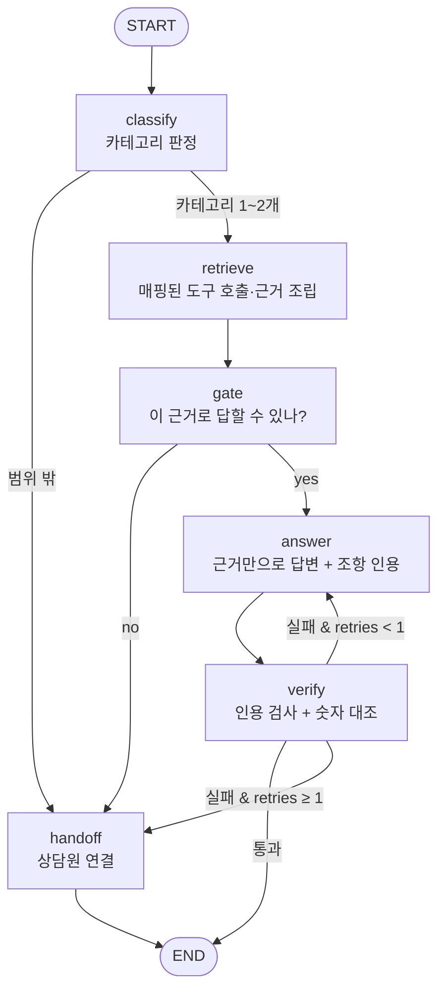

# TECH_SPEC — 모두스테이 고객문의 라우팅 에이전트

> 기술 명세. [PRD.md](PRD.md)의 요구 사항을 "어떻게" 구현할지 정의한다.

## 1. 기술 스택

| 영역 | 선택 | 비고 |
|---|---|---|
| 언어 | Python 3.11+ | venv 사용 |
| LLM | OpenAI `gpt-5.6-luna` (`langchain-openai`) | 판정·게이트·채점은 temperature 0 + 구조화 출력 |
| 파이프라인 | LangGraph `StateGraph` | |
| 구조화 출력 | Pydantic + `with_structured_output` | |
| 데모 | Streamlit | |
| 키 관리 | `python-dotenv`, `.env` (git 제외) | `.env.example`만 커밋 |

## 2. 디렉토리 구조

```
my-routing-agent/
├── docs/                    # 근거 문서 (조항 ID가 붙은 Markdown)
│   ├── sources.md           # 원문 출처 (공정위 문서 URL·발행일)
│   └── policy_modustay.md   # 공정위 기준 + 모두스테이 보충 정책
├── data/
│   └── goldenset.json       # 평가 20건 + 예시 5건 (split 필드로 구분)
├── results/                 # 평가 실행 결과 (run별 JSON)
├── prompts.py               # 분류 지침 · 게이트 지침 · 답변 규칙 · 채점 지침
├── context.py               # 문서 파싱(조항 단위) · 카테고리↔조항 매핑 · 근거 조립
├── verify.py                # 기계적 검증 (인용 검사 + 숫자 대조)
├── agent.py                 # LangGraph 파이프라인
├── evaluate.py              # 두 지표 측정 + 채점기 검증
├── app.py                   # Streamlit 데모
├── requirements.txt
├── .env.example
├── .gitignore
├── PRD.md · TECH_SPEC.md · WORK_UNITS.md · FINAL_CHECKLIST.md
└── REPORT.md
```

## 3. 근거 문서 형식 (`docs/`)

- 조항 하나 = 하나의 `###` 헤딩, 헤딩 앞에 **조항 ID**를 붙인다.
  ```markdown
  ### [REF-02] 비수기 주중 취소 시 환급 기준
  사용예정일 ... 
  ```
- 조항 ID 접두어 = 카테고리. 매핑표의 단위가 된다.

| 접두어 | 카테고리 | 도구 |
|---|---|---|
| `BKG-` | 예약·결제 | `get_booking` |
| `REF-` | 취소·환불 | `get_refund` |
| `STY-` | 체크인·이용규칙 | `get_stay_rules` |
| `DSP-` | 분쟁·보상 | `get_dispute` |
| — | 범위 밖 | `handoff` |

- 공정위 원문에서 가져온 조항과 모두스테이가 보충한 조항을 구분해 표시한다 (`출처: 공정위 / 보충`).

## 4. 카테고리 ↔ 조항 매핑 (`context.py`)

```python
CATEGORY_TOOL = {
    "예약·결제": "get_booking",
    "취소·환불": "get_refund",
    "체크인·이용규칙": "get_stay_rules",
    "분쟁·보상": "get_dispute",
}
# 조항 ID 접두어로 자동 매핑. 예외(한 조항을 두 카테고리가 써야 할 때)는 EXTRA_MAP에 명시.
PREFIX_CATEGORY = {"BKG": "예약·결제", "REF": "취소·환불", "STY": "체크인·이용규칙", "DSP": "분쟁·보상"}
```

- `load_clauses() -> list[Clause]` : 문서를 조항 단위로 파싱. `Clause = {id, category, title, text, source}`
- 도구 함수 `get_refund()` 등은 해당 카테고리 조항 목록을 반환하고, 호출 사실을 상태의 `tools_called`에 남긴다.
- **문서 전체를 프롬프트에 넣지 않는다.** 판정된 카테고리의 조항만 조립한다.

## 5. 상태 (State)

```python
class AgentState(TypedDict):
    question: str
    categories: list[str]        # 분류 결과 (최대 2개, 범위 밖이면 ["범위 밖"])
    tools_called: list[str]      # 실제 호출한 도구, 호출 순서대로
    context: list[Clause]        # 조립된 근거 조항
    answerable: bool             # 게이트 판단
    gate_reason: str
    answer: str
    citations: list[str]         # 답변이 인용한 조항 ID
    verification: dict           # {passed, unknown_citations, unsupported_numbers, uncited_sentences}
    retries: int                 # 재생성 횟수 (최대 1)
    handoff: bool
```

## 6. 파이프라인 (LangGraph)



| 노드 | 입력 | 출력 | 방식 |
|---|---|---|---|
| `classify` | question | categories | LLM 구조화 출력. 카테고리만 고른다 (넘길지 판단하지 않음) |
| `retrieve` | categories | tools_called, context | **코드**가 매핑표대로 도구 호출 (LLM이 도구를 고르지 않음) |
| `gate` | question, context | answerable, gate_reason | LLM 구조화 출력. "조립된 근거만으로 답할 수 있는가" yes/no |
| `answer` | question, context, (이전 위반 내역) | answer, citations | 모든 문장 끝에 `[REF-02]` 형태 인용 강제. 재시도 시 위반 내역을 프롬프트에 추가 |
| `verify` | answer, context | verification | 코드 검사 (7절) |
| `handoff` | — | answer(고정 문구), handoff=True, tools_called += handoff | 고정 문구: "정확한 안내를 위해 상담원에게 연결해 드리겠습니다." |

**판정과 넘기기 분리**: `classify`는 카테고리 선택만, `gate`는 근거 조립 후 답변 가능 여부만 판단한다.

## 7. 기계적 검증 (`verify.py`)

LLM 없이 코드로만 검사한다. 하나라도 걸리면 실패.

1. **미인용 문장**: 답변을 문장 단위로 나눠 `[XXX-00]` 인용이 없는 문장을 찾는다.
2. **모르는 인용**: 인용된 조항 ID가 `context`에 없는 경우 (조립하지 않은 조항을 지어낸 것).
3. **근거 없는 숫자**: 답변 속 숫자 표현(정규식: 숫자 + `%`, `일`, `시간`, `시`, `분`, `원`, `배`, `회`, `명`, `박` 등)을 추출해, 그 문장이 인용한 조항 텍스트에 같은 값이 있는지 대조한다.
   - 정규화: `10%`↔`10 %`, `1만원`↔`10,000원`, `하루`↔`1일` 등 기본 변환표 적용.
   - 숫자를 뽑기 전에 인용 표시(`[REF-02]`)를 지운다. 지우지 않으면 "02"가 근거 없는 숫자로 잡힌다 (WU-04 평가셋 점검 때 확인).
   - 질문에 나온 숫자(예: "4명 기준 객실")는 사용자가 준 사실이므로 근거가 없어도 허용한다.
   - 한계: 숫자가 없는 지어냄(예: "반려동물 동반 가능")은 못 잡는다 → 게이트 + 평가의 금지 표현으로 보완. REPORT 회고에 기록.

## 8. 평가 (`evaluate.py`)

### 8.1 평가셋 스키마 (`data/goldenset.json`)

```json
{
  "id": "E01",
  "split": "eval",
  "question": "성수기 주말 예약을 3일 전에 취소하면 얼마나 돌려받나요?",
  "category": "취소·환불",
  "expected_tools": ["get_refund"],
  "must_include": ["..."],
  "must_not": ["전액 환불", "..."],
  "reference_answer": "모범 답안 (채점기 검증용)",
  "note": "근거 조항 ID, 출제 의도"
}
```

- `split`: `"eval"` 20건 / `"example"` 5건. 예시용은 `prompts.py`의 few-shot에만, 평가용은 평가에만 쓴다.
- **기대 도구 규칙**
  - 범위 밖: `["handoff"]`
  - 카테고리는 있으나 문서에 답 없음: `["get_xxx", "handoff"]` (근거를 읽어 보고 넘겨야 정답)
  - 두 카테고리에 걸친 문의: 두 도구 모두

### 8.2 지표

| 지표 | 계산 |
|---|---|
| 도구 호출 적절성 | `set(tools_called) == set(expected_tools)` → 1/0, 평균 |
| 답변 적절성 | LLM 채점기: `must_include` 항목별 포함 여부 + `must_not` 항목별 위반 여부 → 전부 포함 & 위반 0이면 1, 평균 |

- 채점기 지침에 "표현이 아니라 **사실**이 같은지 판단하라"를 명시한다.
- 채점기 출력(구조화): `{facts: [{fact, included, evidence}], violations: [{item, violated, evidence}]}`
- 넘기기가 정답인 문항(`handoff` 포함)의 `must_include`는 "상담원 연결 안내"로 둔다.

### 8.3 채점기 검증

1. `reference_answer` 20건을 채점 → 전부 1점이어야 한다.
2. 일부러 틀린 답(필수 사실 누락 / 금지 표현 포함)을 몇 건 만들어 채점 → 0점이어야 한다.
3. 통과 못 하면 채점 지침이나 평가셋 문구를 고친 뒤 다시 검증한다.

### 8.4 결과 기록

- 실행마다 `results/run_<번호>_<변경점>.json` 저장: 문항별 `tools_called`, `answer`, `verification`, 채점 근거, 두 점수.
- 틀린 건은 원인 분류: `분류 오류` / `게이트 오류(넘겨야 하는데 답함·답해야 하는데 넘김)` / `사실 누락` / `금지 표현(지어냄)` / `검증 오탐`.
- 개선 기록표(REPORT.md): `회차 | 바꾼 것 하나 | 도구 적절성 | 답변 적절성 | 메모`.

## 9. 데모 (`app.py`)

- 입력창 + 예시 질문 버튼.
- 결과 영역: 답변 / 판정 카테고리 / 호출한 도구 / 근거 조항(ID·제목·본문, 펼치기) / 게이트 판단·사유 / 검증 결과(통과·실패 항목) / 재시도·넘기기 여부.
- API 키는 `.env` 또는 Streamlit secrets에서 읽는다. 저장소에 올리지 않는다.

## 10. 실행 방법

```bash
python -m venv .venv && source .venv/bin/activate
pip install -r requirements.txt
cp .env.example .env   # OPENAI_API_KEY 입력
python evaluate.py --validate-grader   # 채점기 검증
python evaluate.py --tag baseline      # 평가 실행
streamlit run app.py                   # 데모
```
